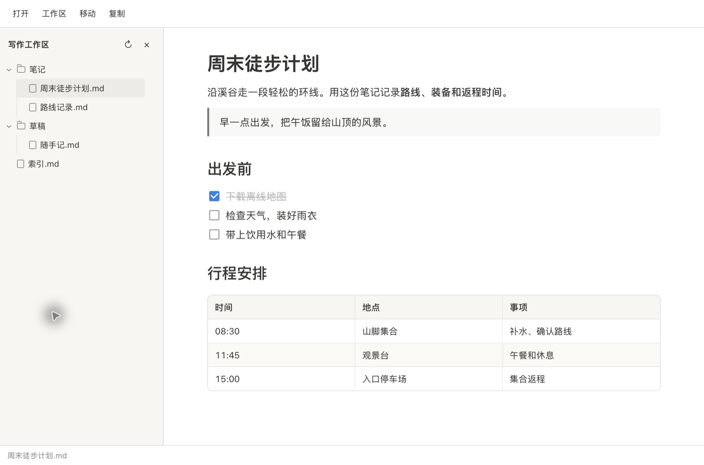
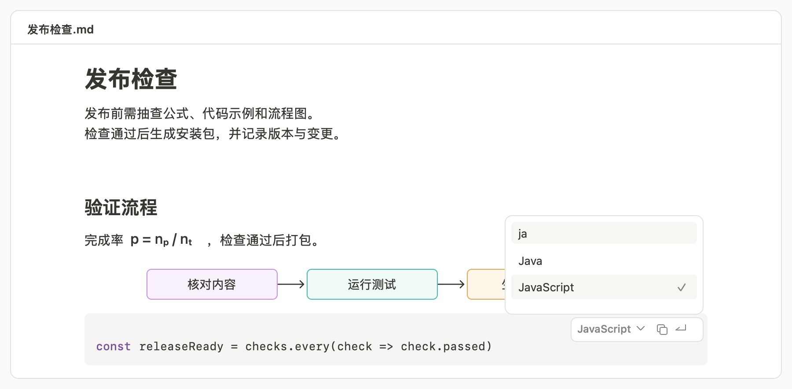
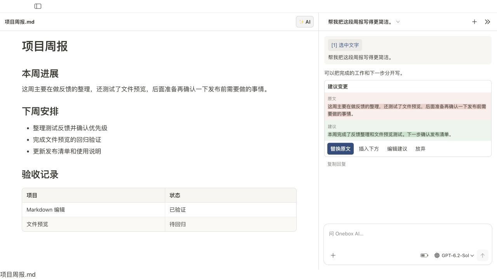
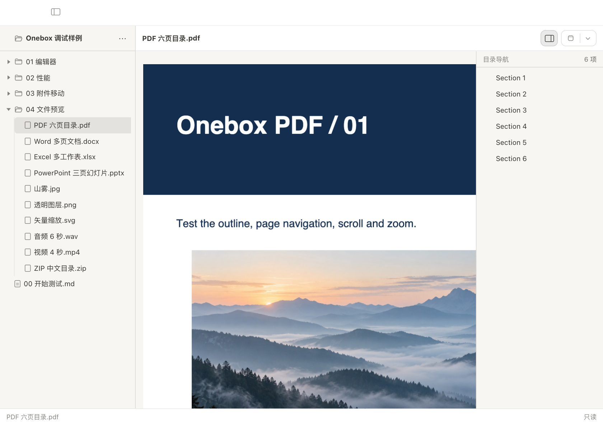
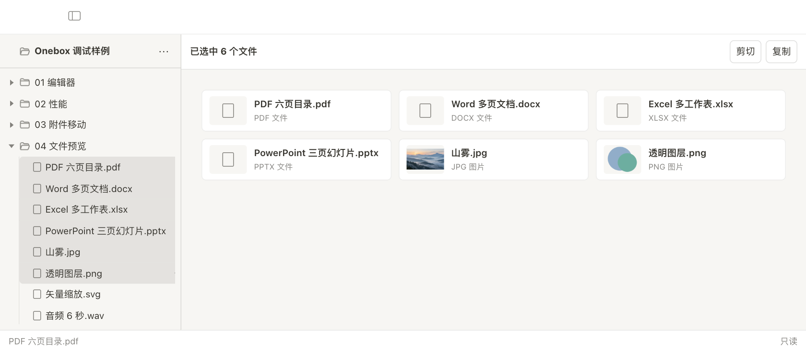

# Onebox

Onebox 是一款本地桌面 Markdown 编辑器与文件工作区。可以在同一个窗口写笔记、整理文件和查看 PDF、Office 文档、图片与压缩包。笔记直接保存为磁盘上的 `.md` 或 `.markdown` 文件。

[核心功能](#核心功能) · [界面截图](#界面截图) · [快速开始](#快速开始) · [连接 AI](#连接-ai) · [本地开发](#本地开发)



## 核心功能

### Markdown 编辑

- **块式编辑**。单击正文左侧空白选中对应区块或列表项，在列表左侧拖动可连选多项。直接在列表文字上拖动时只选文字。拖动单个区块的手柄可调整顺序。输入 `/` 或右键打开区块菜单，插入标题、列表、待办、引用、代码块、表格和附件。支持代码高亮、脚注、嵌套列表，以及表格行列编辑。
- **公式与图表**。在正文中渲染行内和块级 LaTeX、Mermaid 流程图和 ECharts 图表。鼠标移入公式会显示编辑边界，移入图表会显示工具条，可就地编辑公式、图表源码和配置。
- **代码块**。鼠标移入代码块时，右上角显示语言、复制和继续写正文的操作。语言列表支持搜索。
- **本地保存**。编辑已有文档时自动保存，也可另存为。遇到可能无法安全写回的 Markdown 语法，会以只读方式打开。大文档使用分批解析与按视口渲染，样例包含十万字符和百万字符文档。
- **图片与附件**。可以插入、拖入或粘贴本地附件。应用导入的附件保存在文档旁的 `assets/`，正文以相对路径引用。

### 文件工作区

- **用工作树管理本地目录**。可以新建、重命名、拖动、复制、剪切和粘贴文件及文件夹。文件夹展开、收起时会保留现有的文件选区。
- **批量操作文件**。用 Shift 连选，用 Ctrl 或 ⌘ 点选。右侧列出所选文件和图片缩略图，支持批量复制、剪切以及点击单个文件弹出预览。
- **与 Finder 互通**。macOS 上可以在 Finder 复制文件或文件夹，再到 Onebox 工作树中粘贴，也可以从 Onebox 复制到 Finder。剪切到 Finder 时用 ⌥⌘V 移动。复制遇到同名项会生成带编号的副本。
- **移动文档时维护链接**。在工作区内移动 Markdown 时，符合条件的本地附件可随文档移动，相关的相对链接会更新。

### 本地文件预览

单击文件即可在 Onebox 内查看，也可以通过「打开方式」交给系统应用。常规预览在本机完成，渲染资源随应用提供。

| 类型 | 可以查看和操作 |
| --- | --- |
| PDF | 连续滚动、调整目录栏宽度、按目录跳转到对应页面 |
| Office | 预览常见的新旧版 Word、Excel 和 PowerPoint 文件，切换 Excel 工作表 |
| 图片 | 查看 PNG、JPEG、GIF、WebP、AVIF、SVG、TIFF 等格式，支持旋转、缩放、拖动和适配窗口 |
| 文本和音视频 | 预览 UTF-8、UTF-16、GB18030 文本，播放 MP4、WAV 等媒体文件 |
| 压缩包 | 浏览 ZIP、TAR.GZ、7Z 中的文件，预览其中支持的格式，或将单个文件另存到本地 |

WPS 原生文档及模板（`.wps`、`.et`、`.dps`、`.wpt`、`.ett`、`.dpt`）需要本机安装 LibreOffice。Onebox 会在本地转换临时副本供只读预览，原文件保持原格式。

### AI 写作侧栏

- **正文编辑**。选中文字后，右键点「AI → 正文编辑」，在正文里输入修改要求。
- **引用到侧栏**。选中文字后，右键点「AI → 引用到侧栏」，将选区添加到右侧 AI 输入框。也可从输入框旁的「＋」添加其他引用。
- **审阅修改**。侧栏生成建议后，会在正文预览替换或插入。点「撤销」收起预览，点「✓ 确认」才保存改动。也可以编辑建议后重新预览。确认后仍可撤销本条改动。
- **切换会话**。侧栏顶部的「＋」开启新会话。从标题下拉可以按日期浏览、搜索和切换同一文档的会话。会话保留到本次 Onebox 退出，拖动侧栏边缘设置的宽度会记住。

## 界面截图

### 代码、公式与图表



以上两张界面示意使用同一份样例文档，分别展示 AI 运行和代码语言选择。

### AI 写作与修改建议



截图使用样例文档和对话。侧栏底部是模型菜单，旁边的电池图标可查看用量。

### PDF 预览与文档目录



### 多选文件与图片缩略图



## 快速开始

项目目前处于早期开发阶段，可以从源码运行。准备 Git、Node.js（建议 24 或 26）、pnpm 和通过 `rustup` 安装的 Rust 稳定工具链。macOS 可用 `xcode-select --install` 安装命令行工具。Windows 和 Linux 的桌面依赖见 [Tauri v2 环境准备](https://v2.tauri.app/start/prerequisites/)。

```sh
git clone https://github.com/richaction/onebox.git
cd onebox
pnpm install --frozen-lockfile
pnpm dev:app
```

启动后，在侧栏点击「打开文件夹…」选择本地目录。也可以选「打开调试样例」，体验 Markdown、Office、PDF、图片、音视频和大文档。开发版第一次打开样例时会创建独立的可编辑副本。

### 连接 AI

1. 安装官方 Codex CLI，或在 macOS 上安装带有 Codex 的 ChatGPT 或 Codex 桌面版。AI 侧栏通过本机的 Codex 连接服务。
2. 打开一个 Markdown 文件，点击标题栏右侧的「✨ AI」，再从输入框旁的模型菜单选择「使用 ChatGPT 登录」，在浏览器中完成登录。
3. 从模型菜单选择账号可用的模型和该模型提供的思考强度。将鼠标移到电池图标可查看 Codex 返回的额度和重置时间。实际额度和周期以账号返回的数据为准。

AI 连接默认跟随系统代理。发送时，提问和添加的引用会交给 Codex 处理。AI 登录与本地编辑、文件管理和常规预览相互独立。

### 常用操作

| 操作 | 快捷键或入口 |
| --- | --- |
| 打开文件或工作区 | ⌘O 打开文件，⌘⇧O 打开工作区 |
| 插入区块 | 在正文输入 `/`，也可以右键打开区块菜单 |
| 多选文件 | Shift 连选，Ctrl 或 ⌘ 点选 |
| 复制、剪切和粘贴 | ⌘C、⌘X、⌘V，也可以用工作树右键菜单。点击工作区名称后粘贴到根目录 |
| 保存与另存为 | 编辑时自动保存，⌘S 查看保存提示，⌘⇧S 另存为 |
| 关闭弹出预览或取消剪切 | Esc |

Windows 和 Linux 上，可在 Onebox 内用 Ctrl 代替上述 ⌘ 组合键。

### 构建 macOS 应用

安装依赖后，从仓库根目录运行构建命令。

```sh
pnpm tauri build --bundles app --config '{"bundle":{"active":true}}'
open src-tauri/target/release/bundle/macos/Onebox.app
```

构建得到的 `Onebox.app` 可拖到 Finder 的「应用程序」目录。只需要当前平台的可执行文件时，可运行 `pnpm tauri build --no-bundle`。[Tauri 打包说明](https://v2.tauri.app/distribute/macos-application-bundle/)

## 本地开发

| 命令 | 用途 |
| --- | --- |
| `pnpm dev:app` | 启动或唤回桌面调试窗口 |
| `pnpm dev:status` | 查看调试状态和日志位置 |
| `pnpm dev:restart` / `pnpm dev:stop` | 保存会话后重启或停止调试 |
| `pnpm dev` | 在 `http://localhost:1420` 调试前端界面 |
| `pnpm typecheck` / `pnpm test` | 检查 TypeScript 类型和运行前端测试 |
| `cargo test --locked --manifest-path src-tauri/Cargo.toml` | 运行 Rust 测试 |
| `pnpm build` | 将前端静态产物构建到 `dist/` |

`pnpm dev:app` 维护一个桌面调试实例。前端热更新会保留文档、光标、滚动位置和撤销记录。Rust 或原生配置变更后，调试进程先保存文档，再重启并恢复工作区。文件对话框、剪贴板和磁盘操作请在桌面窗口中验证。

项目使用 Tauri v2、Rust、SolidJS 和 Tiptap。编辑器和 Markdown 转换在 [`src/core/`](src/core)，界面在 [`src/ui/`](src/ui)，桌面文件操作在 [`src-tauri/src/`](src-tauri/src)，多格式预览使用 Flyfish Full。

### 设计与验证资料

- [调试样例与操作清单](examples/manual-testing/00%20开始测试.md)
- [原始需求与技术方案](docs/高性能块式Markdown编辑器技术方案.md)
- [第一阶段验收](docs/superpowers/plans/2026-11-15-onebox-foundation-verification.md)
- [第二阶段计划与验收](docs/superpowers/plans/2026-11-15-onebox-phase-two.md)
- [工作区设计与验收](docs/superpowers/plans/2026-11-15-onebox-workspace.md)

项目采用 [MIT 许可证](LICENSE)。
