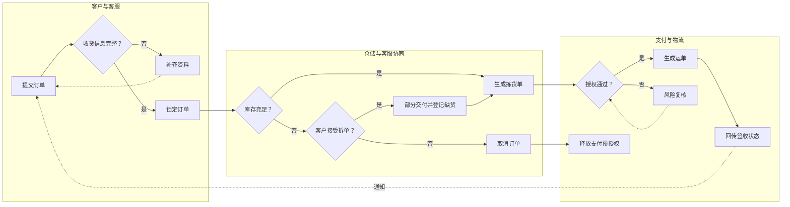
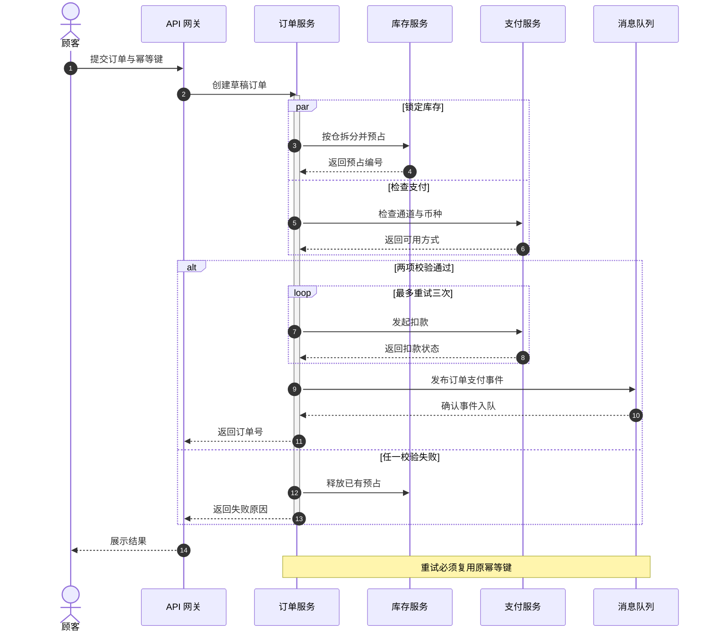
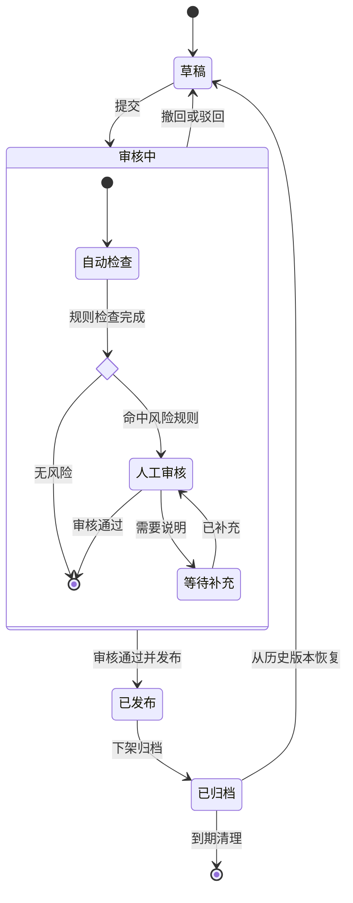
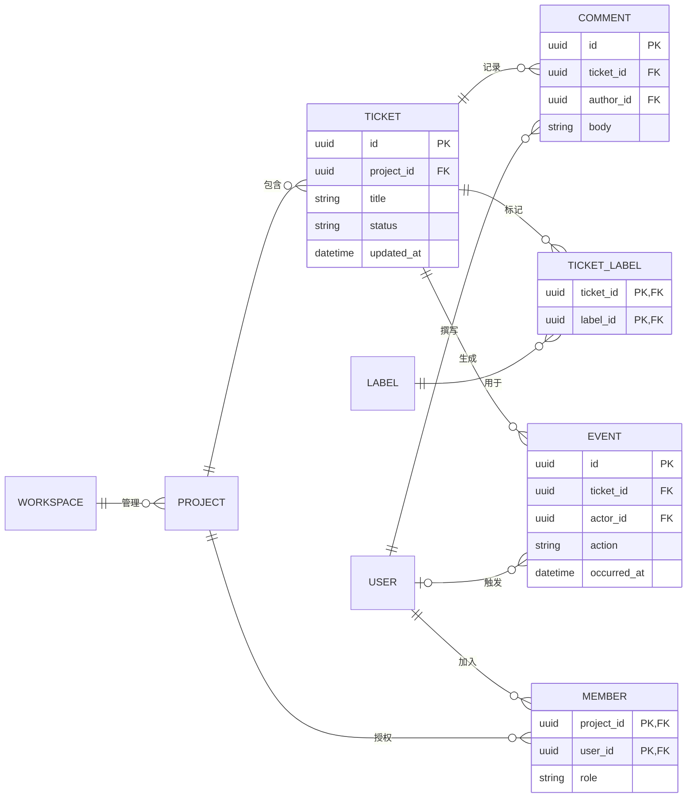

# Mermaid 多场景编辑

点每张图右上角的「编辑」，左侧改源码，右侧看结果。每节列了两处可以改的地方。改完可撤销，或者关闭并重新打开文件核对保存结果。

## 跨团队订单履约

把 `LR` 改成 `TB`，观察方向和子图区的变化。再给「风险复核」加一条指向「取消订单」的拒绝分支。

## 异步支付与库存校验

在并发段增加一条优惠券校验。再暂时删掉与 `loop` 配对的 `end`，看错误行号和上次预览，补回后确认图恢复。

## 内容审核与发布状态

在「人工审核」后加入「法务审核」。再给「已发布」加一个返回草稿的回滚路径。

## 工单、评论与协作者

给评论增加一个指向父评论的关系。再给协作者表增加一个带 `UK` 的成员键，核对实体字段和连线随修改更新。

