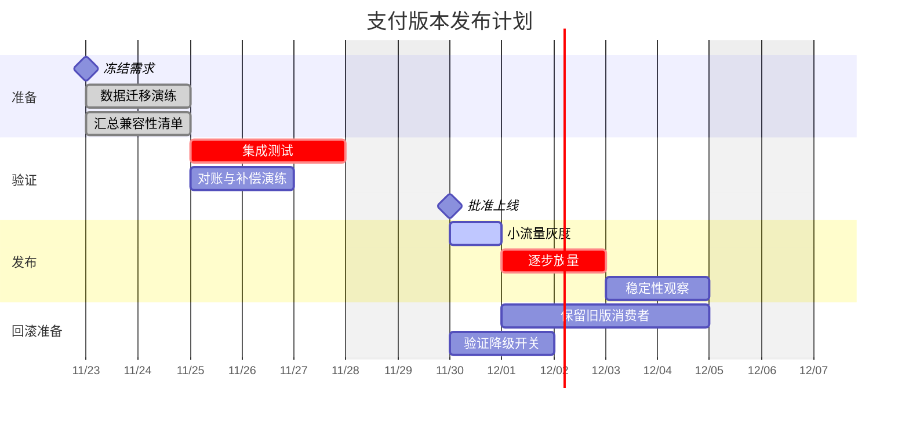
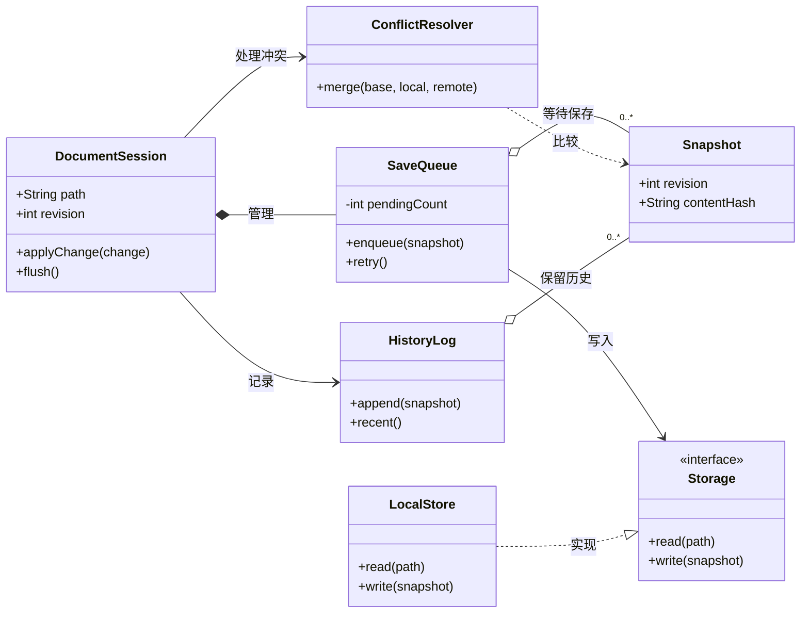
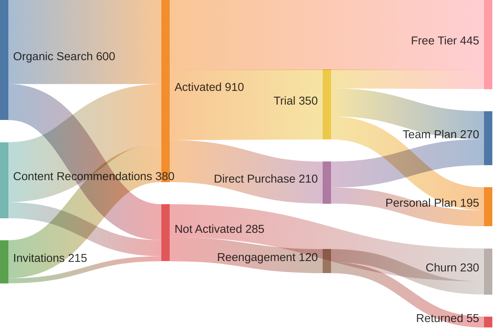
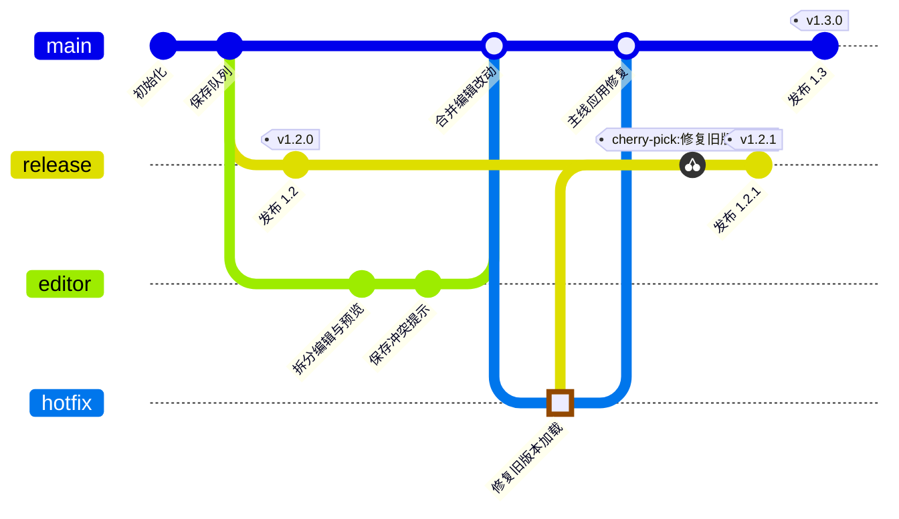

# Mermaid 联调与压力样张

这四张图覆盖发布、代码结构、数据流和项目推广。可以连续修改两张图，在编辑与预览间切换，再滚到文末回到第一张图，检查预览与保存结果。

## 有回滚的发布计划

把「小流量灰度」从一天改为三天，观察后续任务是否顺延。再给「批准上线」增加一项依赖，例如 `after verify reconcile`。

## 文档保存与并发冲突

为 `SaveQueue` 增加一个 `cancel` 方法，再为 `LocalStore` 增加一个云端实现，观察结构和多种关系线的排布。

## 注册到付费的流量分布

把 `Organic Search` 到 `Activated` 的数量从 420 改为 460，并将对应的 `Not Activated` 人数减少 40。再调整这两个节点的下游数量，使流入和流出相等。

## 双版本维护与补丁回迁

把「保存冲突提示」改成 `type: HIGHLIGHT`，再给维护分支加第二次回迁。可以将这段连同外层 Markdown 围栏一起复制，粘贴替换另一张 Mermaid 图的全部源码。

