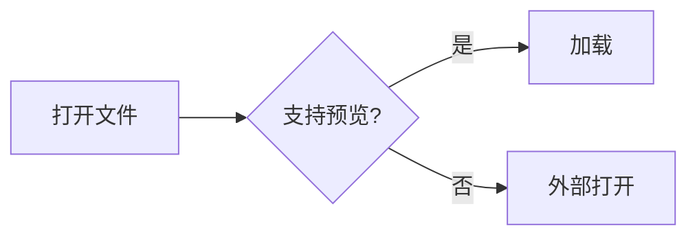
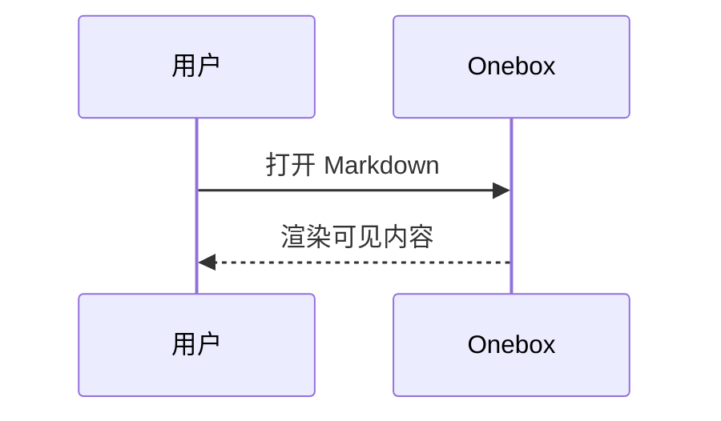
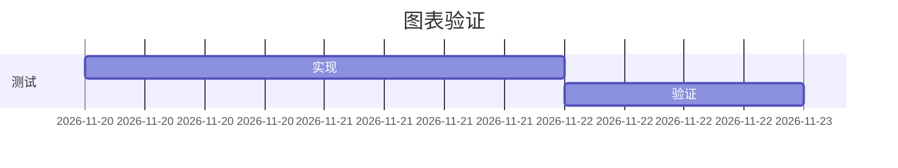
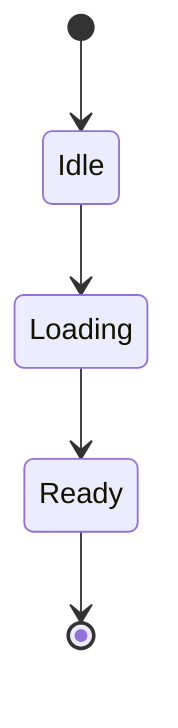
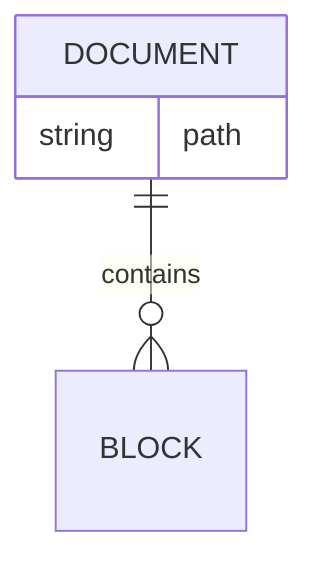
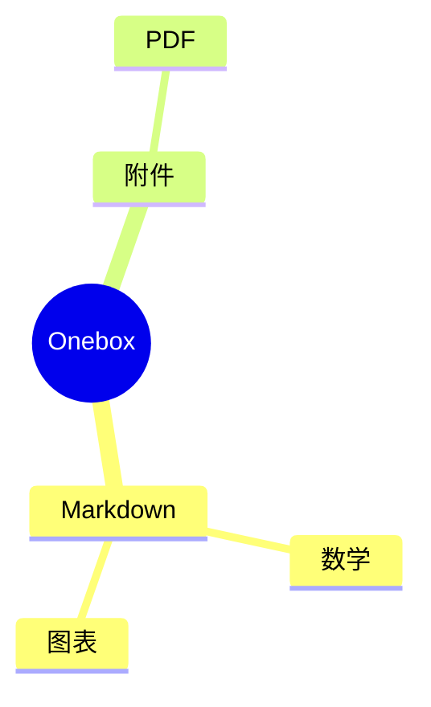

# 图表、数字与公式

在正文输入 /图表、/流程图 或 /公式。点图表右上角「源码」可修改配置，点击公式可修改 LaTeX。

## 数字与 GFM 表格

| 金额 | 比率 | 科学计数 | 大整数文本 |
| ---: | ---: | ---: | ---: |
| ¥1,234,567.89 | −0.025% | 6.022×10²³ | 9007199254740993 |
| \$1,234.50 | 100.00% | 1e−9 | 000123 |

## 行内与块级 LaTeX

行内面积 $A = \pi r^2$，平方根 $\sqrt{2}$，分段函数与矩阵见下方。

$$
\int_0^\infty e^{-x^2}\,dx = \frac{\sqrt{\pi}}{2}
$$

$$
\begin{bmatrix}
1 & 2 \\
3 & 4
\end{bmatrix}
\quad f(x)=\begin{cases}
x^2 & x\ge 0 \\
-x & x<0
\end{cases}
$$

$$
\begin{aligned}
\nabla \cdot \mathbf{E} &= \rho/\varepsilon_0 \\
\sum_{n=1}^{\infty}\frac{1}{n^2} &= \frac{\pi^2}{6}
\end{aligned}
$$

## Mermaid













## 柱状图

```echarts
{"xAxis":{"type":"category","data":["一月","二月","三月","四月","五月"]},"yAxis":{"type":"value"},"series":[{"type":"bar","data":[12,19,14,23,30]}]}
```

## 折线图

```echarts
{"xAxis":{"type":"category","data":["一月","二月","三月","四月","五月"]},"yAxis":{"type":"value"},"series":[{"type":"line","data":[12,19,14,23,30]}]}
```

## 饼图

```echarts
{"series":[{"type":"pie","radius":["35%","65%"],"data":[{"name":"一月","value":12},{"name":"二月","value":19},{"name":"三月","value":14},{"name":"四月","value":23},{"name":"五月","value":30}]}]}
```

## 散点图

```echarts
{"xAxis":{},"yAxis":{},"series":[{"type":"scatter","data":[[2,5],[5,4],[7,11],[9,8],[12,15]]}]}
```

## 雷达图

```echarts
{"radar":{"indicator":[{"name":"速度","max":100},{"name":"质量","max":100},{"name":"成本","max":100},{"name":"稳定","max":100},{"name":"易用","max":100}]},"series":[{"type":"radar","data":[{"value":[77,83,60,92,88]}]}]}
```

## 热力图

```echarts
{"xAxis":{"type":"category","data":["一月","二月","三月","四月","五月"]},"yAxis":{"type":"category","data":["上午","下午"]},"visualMap":{"min":0,"max":30,"show":false},"series":[{"type":"heatmap","data":[[0,0,12],[0,1,18],[1,0,19],[1,1,11],[2,0,14],[2,1,16],[3,0,23],[3,1,7],[4,0,30],[4,1,0]]}]}
```

## K 线图

```echarts
{"xAxis":{"type":"category","data":["一月","二月","三月","四月","五月"]},"yAxis":{"type":"value"},"series":[{"type":"candlestick","data":[[12,16,10,18],[19,23,17,25],[14,18,12,20],[23,27,21,29],[30,34,28,36]]}]}
```

## 箱线图

```echarts
{"xAxis":{"type":"category","data":["一月","二月","三月","四月","五月"]},"yAxis":{"type":"value"},"series":[{"type":"boxplot","data":[[7,10,12,15,19],[14,17,19,22,26],[9,12,14,17,21],[18,21,23,26,30],[25,28,30,33,37]]}]}
```

## 矩形树图

```echarts
{"series":[{"type":"treemap","data":[{"name":"一月","value":12},{"name":"二月","value":19},{"name":"三月","value":14},{"name":"四月","value":23},{"name":"五月","value":30}]}]}
```

## 漏斗图

```echarts
{"series":[{"type":"funnel","data":[{"name":"一月","value":12},{"name":"二月","value":19},{"name":"三月","value":14},{"name":"四月","value":23},{"name":"五月","value":30}]}]}
```

## 仪表盘

```echarts
{"series":[{"type":"gauge","data":[{"value":72}]}]}
```

## 桑基图

```echarts
{"series":[{"type":"sankey","data":[{"name":"访问"},{"name":"注册"},{"name":"付费"}],"links":[{"source":"访问","target":"注册","value":30},{"source":"注册","target":"付费","value":12}]}]}
```

## 气泡图

```echarts
{"xAxis":{},"yAxis":{},"visualMap":{"dimension":2,"min":5,"max":25,"inRange":{"symbolSize":[8,46]}},"series":[{"type":"scatter","data":[[1,4,5],[3,8,12],[7,5,25]]}]}
```

## 涟漪散点

```echarts
{"xAxis":{},"yAxis":{},"series":[{"type":"effectScatter","data":[[1,4],[3,8],[7,5]]}]}
```

## 关系图

```echarts
{"series":[{"type":"graph","layout":"circular","symbolSize":45,"label":{"show":true},"data":[{"name":"A"},{"name":"B"},{"name":"C"}],"links":[{"source":"A","target":"B"},{"source":"B","target":"C"}]}]}
```

## 树图

```echarts
{"series":[{"type":"tree","data":[{"name":"根","children":[{"name":"甲"},{"name":"乙"}]}]}]}
```

## 旭日图

```echarts
{"series":[{"type":"sunburst","data":[{"name":"华东","children":[{"name":"上海","value":20},{"name":"杭州","value":12}]},{"name":"华南","value":18}]}]}
```

## 平行坐标

```echarts
{"parallelAxis":[{"dim":0},{"dim":1},{"dim":2}],"series":[{"type":"parallel","data":[[1,9,4],[2,4,7],[3,6,2]]}]}
```

## 主题河流

```echarts
{"singleAxis":{"type":"time"},"series":[{"type":"themeRiver","data":[["2026-01-01",5,"甲"],["2026-01-02",8,"甲"],["2026-01-01",3,"乙"],["2026-01-02",2,"乙"]]}]}
```

## 象形柱图

```echarts
{"xAxis":{"type":"category","data":["甲","乙","丙"]},"yAxis":{},"series":[{"type":"pictorialBar","symbol":"roundRect","symbolRepeat":true,"data":[5,8,3]}]}
```

## 离线地图

```echarts
{"geoJSON":{"type":"FeatureCollection","features":[{"type":"Feature","properties":{"name":"甲"},"geometry":{"type":"Polygon","coordinates":[[[0,0],[1.5,0],[1.5,1],[0,1],[0,0]]]}},{"type":"Feature","properties":{"name":"乙"},"geometry":{"type":"Polygon","coordinates":[[[2,0],[3.5,0],[3.5,1],[2,1],[2,0]]]}}]},"visualMap":{"min":0,"max":100},"series":[{"type":"map","data":[{"name":"甲","value":70},{"name":"乙","value":30}]}]}
```
